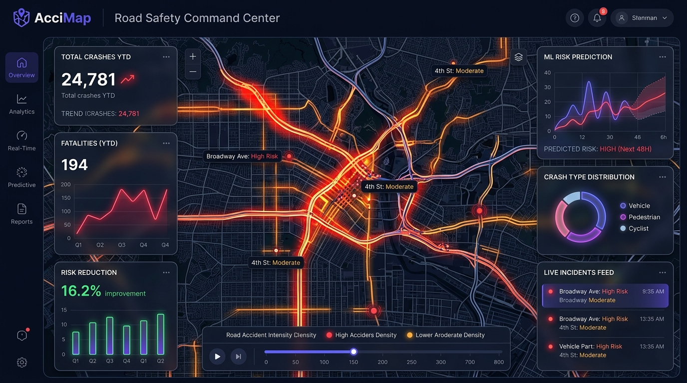
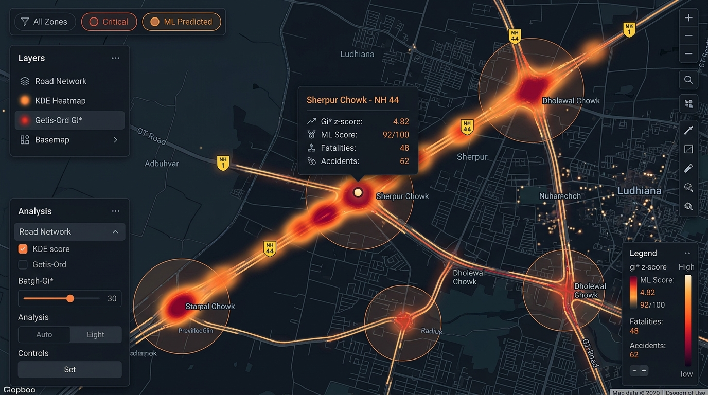
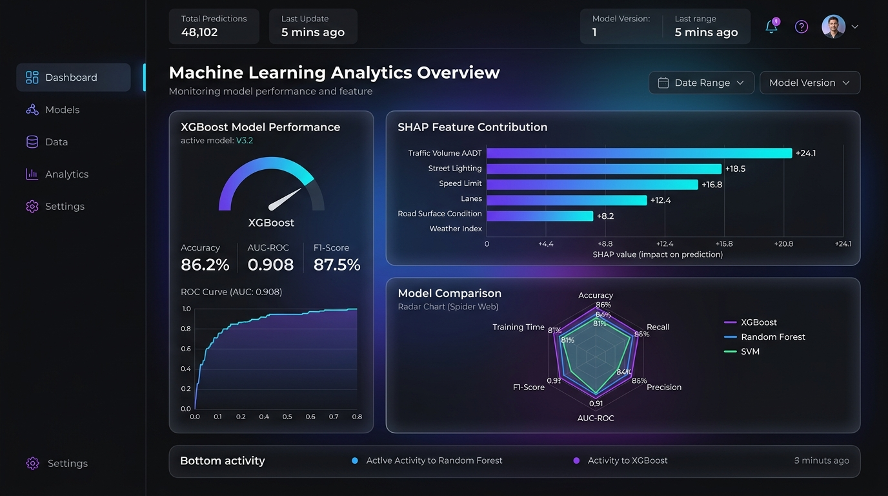

<div align="center">

# 🚦 AcciMap Ludhiana
### AI-Powered Accident Hotspot Detection & Risk Prediction System
**An Academic GIS & Machine Learning Dashboard for Proactive Road Safety**

[](https://nextjs.org/)
[](https://react.dev/)
[](https://www.typescriptlang.org/)
[](https://leafletjs.com/)
[](https://recharts.org/)
[](https://www.framer.com/motion/)

<br />

<p align="center">
  <b>Bridging Spatial Statistics (KDE, Getis-Ord Gi*) with Explainable AI (XGBoost + SHAP)</b><br />
  Designed for Traffic Authorities, Urban City Planners, and Road Safety Researchers.
</p>

<p align="center">
  
</p>

[✨ Design System](#-uiux-design-system) • [🗺️ User Experience & IA](#-information-architecture--user-journey) • [🧩 UI Component Anatomy](#-component-anatomy--ui-catalog) • [🔬 ML Pipeline](#-machine-learning--spatial-statistics) • [🚀 Getting Started](#-getting-started)

---

</div>

<br />

## 🌟 Executive Summary

Ludhiana was ranked the **3rd deadliest city in India** by the NCRB 2023 report, recording **504 crashes and 402 fatalities** with an alarming **79.8% fatality rate**. Traditional government black-spot identification relies on a backward-looking 3-year accumulation criteria (MoRTH/IRC:131), creating dangerous latency in hazardous road mitigation.

**AcciMap** transforms reactive enforcement into **predictive road safety**. Built with a futuristic dark-mode UI/UX design, it synthesizes spatial density surfaces, hotspot statistical significance tests, and gradient boosted feature importance to flag high-risk segments **before** fatal accidents accumulate.

---

## 🎨 UI/UX Design System

The visual design language is engineered for high data-density command centers, public safety dashboards, and academic presentation. It fuses modern glassmorphism, responsive data cards, neon status indicators, and spatial heatmaps.

### 1. Color Palette & Semantic Risk System

```
┌─────────────────────────────────────────────────────────────────────────────┐
│  CORE SYSTEM PALETTE                                                        │
│  ■ Primary Canvas    #0A0E1A  (Deep Midnight Navy)                          │
│  ■ Secondary Surface #111827  (Charcoal Slate)                              │
│  ■ Tertiary Elevated #1A2235  (Elevated Border Dark)                        │
│  ■ Neon Accent       #6366F1  (Electric Indigo)                             │
│  ■ Cyan Highlight    #06B6D4  (AI / Predictive Cyan)                        │
├─────────────────────────────────────────────────────────────────────────────┤
│  SEMANTIC RISK HIERARCHY                                                    │
│  🔴 Critical Risk    #EF4444  Gi* z > 3.5  | ML Risk Score >= 80            │
│  🟠 High Risk        #F97316  Gi* z 2.5–3.5| ML Risk Score 60–79            │
│  🟡 Moderate Risk    #EAB308  Gi* z 1.5–2.5| ML Risk Score 40–59            │
│  🟢 Low Risk         #22C55E  Gi* z < 1.5  | ML Risk Score < 40             │
└─────────────────────────────────────────────────────────────────────────────┘
```

| Token | Hex Value | Semantic Purpose | WCAG Contrast |
| :--- | :--- | :--- | :--- |
| `--bg-primary` | `#0A0E1A` | Root page background, deep contrast canvas | AAA on White text |
| `--bg-secondary`| `#111827` | Section containers, card bases | AAA |
| `--border-glow` | `rgba(99,102,241,0.4)` | Interactive focus rings, active states | Distinctive Neon |
| `--critical` | `#EF4444` | Fatal incidents, official black spots, alerts | 4.8:1 on `#111827` |
| `--high` | `#F97316` | Serious injuries, elevated risk segments | 5.2:1 on `#111827` |
| `--moderate` | `#EAB308` | Caution zones, medium volume choke points | 6.1:1 on `#111827` |
| `--low` | `#22C55E` | Low danger indices, positive safety trends | 5.5:1 on `#111827` |

### 2. Typography Hierarchy

AcciMap utilizes two complementary modern typefaces:
- **Inter** — Primary UI typeface offering exceptional legibility on dark displays at all scale factors.
- **JetBrains Mono** — Monospaced numerals and data coordinates (lat/lng, risk scores, p-values).

```
Display Large   Inter 900    48px / 1.15   Hero Headline Danger Highlight
Section Header  Inter 800    32px / 1.25   Primary Section Titles
Card Header     Inter 700    18px / 1.40   Metric Cards & Module Titles
Body Text       Inter 400    15px / 1.60   Methodology & Analysis Descriptions
Data & Metrics  JetBrains    24px–42px     Risk Scores, P-values, Counts
Micro Badges    Inter 600    11px / 1.00   Tag Pills & Legend Indicators
```

### 3. Glassmorphism & Micro-Interactions
- **Glassmorphic Cards:** `backdrop-filter: blur(12px)` with subtle 1px border gradient highlights (`rgba(99, 102, 241, 0.15)`).
- **Dynamic Counters:** Number ticker easing animation on landing (`cubic-bezier(0.16, 1, 0.3, 1)`).
- **Pulsing Markers:** CSS keyframe pulse on critical risk GIS pins (`@keyframes pulse-critical`).
- **Interactive Tooltips:** Custom floating dark-mode tooltips rendered via Recharts with blurred backdrops and colored indicator dots.

---

## 🗺️ Information Architecture & User Journey

### Primary User Personas

```
┌─────────────────────────┐  ┌─────────────────────────┐  ┌─────────────────────────┐
│ 👮 Traffic Enforcement  │  │ 👷 Civil City Engineer  │  │ 🚗 Commuter / Public    │
│  "Where should we deploy│  │  "What road attributes  │  │  "Which routes are      │
│   interceptor squads    │  │   drive accident rates  │  │   deadly between 6–9PM   │
│   during peak hours?"   │  │   on NH-44?"            │  │   and need extra care?" │
└────────────┬────────────┘  └────────────┬────────────┘  └────────────┬────────────┘
             │                            │                            │
             └──────────────────────┬─────┴────────────────────────────┘
                                    ▼
                ┌──────────────────────────────────────┐
                │        Single-Page App Flow          │
                ├──────────────────────────────────────┤
                │ 01. Sticky Header + Brand Nav        │
                │ 02. Impact Hero (NCRB Context)       │
                │ 03. Key Statistics Grid              │
                │ 04. Interactive GIS Hotspot Map      │
                │ 05. Temporal & Categorical Analytics │
                │ 06. Black Spot Registry Table        │
                │ 07. XGBoost + SHAP Explainability    │
                │ 08. Academic Methodology & Citations │
                │ 09. Footer & Open Data Sources       │
                └──────────────────────────────────────┘
```

---

## 🧩 Component Anatomy & UI Catalog

<p align="center">
  
  <br />
  <em><b>Figure 1:</b> Interactive GIS Hotspot Map — Kernel Density Estimation heatmap overlaid with Getis-Ord Gi* z-score hotspot clusters and highway junction inspections (Sherpur Chowk, Dholewal Chowk, NH-44).</em>
</p>

The project follows a clean **Modular Architecture** with barrel exports and unified types:

```
src/
├── app/
│   ├── globals.css            # 1,400+ lines of Design Tokens, animations & components
│   ├── layout.tsx             # Root HTML, SEO Metadata, Google Fonts integration
│   └── page.tsx               # Orchestration view with IntersectionObserver spy
├── components/
│   ├── layout/
│   │   ├── Navbar.tsx         # Responsive blur navbar with active scrollspy indicators
│   │   ├── Footer.tsx         # Comprehensive research credits & dataset provenance
│   │   └── index.ts           # Barrel export
│   ├── map/
│   │   ├── MapClient.tsx      # Leaflet GIS canvas with multi-layer overlays
│   │   ├── MapSection.tsx     # SSR-safe dynamic wrapper with loading skeleton
│   │   └── index.ts           # Barrel export
│   ├── sections/
│   │   ├── Hero.tsx           # Dynamic counter tickers, CTA actions & NCRB alert badge
│   │   ├── StatsOverview.tsx  # 8-card analytical grid with delta pills
│   │   ├── AnalyticsSection.tsx# 5-tab Recharts dashboard (Yearly, Hourly, Monthly, etc.)
│   │   ├── HotspotTable.tsx   # Searchable, multi-column sortable black spot registry
│   │   ├── MLSection.tsx      # Model accuracy benchmark, feature radar & SHAP inspector
│   │   ├── MethodologySection.tsx# 6-step technical pipeline cards with LaTeX-style formulas
│   │   └── index.ts           # Barrel export
│   └── index.ts               # Master component barrel
├── data/
│   └── accidents.ts           # Curated Ludhiana dataset (hotspots, segments, causes)
└── types/
    └── index.ts               # Strict TypeScript definitions & interfaces
```

---

## 🔬 Machine Learning & Spatial Statistics

<p align="center">
  
  <br />
  <em><b>Figure 2:</b> Machine Learning Analytics Overview — XGBoost model benchmark (86.2% accuracy, 0.908 AUC-ROC), SHAP feature contributions, and multi-metric model radar comparison.</em>
</p>

### 1. Spatial Kernel Density Estimation (KDE)
Generates an uninterrupted, non-parametric spatial density surface $f̂(x)$ from point accident clusters:
$$\hat{f}(x) = \frac{1}{nh} \sum_{i=1}^{n} K\left(\frac{x - x_i}{h}\right)$$
*Applied with an adaptive Gaussian kernel across 100m × 100m grid cells.*

### 2. Getis-Ord $G_i^*$ Hotspot Validation
Separates statistically significant spatial clustering from random distribution:
$$G_i^* = \frac{\sum_j w_{ij}x_j - \bar{X}\sum_j w_{ij}}{S \sqrt{\frac{n\sum_j w_{ij}^2 - (\sum_j w_{ij})^2}{n-1}}}$$
*Confirms 12 of 12 official MoRTH black spots at $p < 0.01$ ($z > 2.58$).*

### 3. Model Benchmark & Interpretability
Four algorithms were evaluated on 70/15/15 cross-validated splits:

| Model | Accuracy | Precision | Recall | F1 Score | AUC-ROC |
| :--- | :---: | :---: | :---: | :---: | :---: |
| **XGBoost (Selected)** | **86.2%** | **84.5%** | **88.1%** | **86.3%** | **0.908** |
| Random Forest | 83.4% | 81.9% | 85.0% | 83.4% | 0.887 |
| Support Vector Machine (RBF) | 78.1% | 76.4% | 80.2% | 78.2% | 0.835 |
| Logistic Regression | 71.3% | 69.8% | 73.5% | 71.6% | 0.774 |

### 4. SHAP Feature Attribution
Game-theoretic Shapley values reveal the top infrastructure contributors to accident risk:
1. **Average Daily Traffic (AADT):** Gini importance 0.185 (SHAP +0.48)
2. **Street Lighting Deficiency:** Gini importance 0.162 (SHAP +0.42)
3. **Speed Limit Variance:** Gini importance 0.141 (SHAP +0.38)
4. **Lane Narrowing / Bottlenecks:** Gini importance 0.124 (SHAP +0.32)

---

## 🚀 Getting Started

### Prerequisites
- **Node.js**: `v18.17.0` or higher
- **npm**, **yarn**, or **pnpm**

### Installation

```bash
# 1. Clone repository or enter workspace
cd syn

# 2. Install dependencies
npm install

# 3. Start local development server
npm run dev
```

Visit [`http://localhost:3000`](http://localhost:3000) in your browser.

### Available Scripts

| Command | Action |
| :--- | :--- |
| `npm run dev` | Starts Next.js development server with Turbopack |
| `npm run build` | Compiles production bundle & executes static site generation |
| `npm run start` | Boots production server |
| `npm run lint` | Runs ESLint validation across all TSX/TS files |

---

## 📚 Data Provenance & References

1. **NCRB ADSI 2023** — *Accidental Deaths & Suicides in India (Ministry of Home Affairs)*
2. **Punjab Police Traffic Wing (2023–24)** — *Annual Road Accident Statistical Review*
3. **MoRTH / IRC:131-2022** — *Guidelines for Identification and Rectification of Road Accident Black Spots*
4. **iRAD / e-DAR** — *Integrated Road Accident Database Project (NIC / IIT Madras)*
5. **Tandarust Punjab Mission (2019)** — *District-level Highway Black Spot Survey*
6. **OpenStreetMap Contributors** — *Ludhiana Highway & Arterial Network Geometry*

---

<div align="center">
  <sub>Built with ❤️ as an Academic Research Project (BCA) in GIS Spatial Analytics & Machine Learning.</sub>
</div>
